# GymPassJUST final report

SE440 CSP11 | University Sports Center Membership and Class Booking

Jordan University of Science and Technology

2 November 2026 | English report

Final target: 9 January 2027. This report covers sections 0–20 and the current local result.

The system lets students buy a plan, book a class and show a QR to the instructor for attendance. This report explains the plan and current local result. Appendix A holds the detailed diagrams. Proposed roles are listed in section 3; student IDs, actual authors and final approval still need confirmation.

[TOC]

# 0 Project charter and business case

Proposed section owner M1.

GymPassJUST helps the university sports center manage plans, class bookings and QR attendance. The proposed sponsor is the Sports Center Director, represented by the TA for this course. The aim is fair booking: never exceed the seat limit and give a free seat to the first eligible student in the waiting list. A proposed user test will check a booking in at most three screens and under 30 seconds with five participants. That test still needs real participants.

The plan is for four students over 14 weeks, with eight hours per person each week. This gives 448 hours: 384 planned hours and 64 hours for known risks. At an assumed JOD 5 per hour, the baseline is JOD 2,240. These are estimates, not money already spent.

The business example assumes JOD 1,800 benefit and JOD 800 maintenance each year, leaving JOD 1,000. For three years at 8%: NPV = -2240 + 1000/1.08 + 1000/1.08^2 + 1000/1.08^3 = JOD 337.10. NPV compares the initial cost with the value of future benefits today. The benefit estimate needs sponsor approval.

# 1 Introduction and project overview

Proposed section owner M1.

The system has three account types: student, instructor and manager. Students buy a plan and book classes. Instructors publish their classes and scan students' QR codes. The manager handles accounts, plans, classes and reports. The interface switches between Arabic and English.

A normal first launch creates four login accounts and three plan options. It does not create memberships or classes. Counts come from records saved through the system. The large set of test students is used only in isolated tests. Payments are simulated, and the accounts are separate from official university accounts. The course brief assumes 5–7 students; this plan uses the four-member team supplied for the project.

# 2 Development approach and life cycle

Proposed section owner M1.

Use three small sprints: login and plans; booking and waiting lists; then QR attendance and reports. At the end of each sprint, show the working pages and check the related rules. Review the next tasks before starting them.

Keep the first release small enough for four students to explain and maintain. Record a requested change, its effect on time and effort, and who should approve it. The supplied course dates remain the submission baseline.

# 3 Project organization and governance

Proposed section owner M1.

The assignments below are a proposed division of work for four members. M1 to M4 match team.json. The students still need to add their IDs and actual contributions.

In the RACI table, R does the work, A approves it, C gives advice and I receives updates. Hold a short weekly meeting. Bring unresolved scope or deadline problems to the TA. These tables are a plan, not a record of completed student work.

| Member | Main duty |
| --- | --- |
| M1 Asia Bassam Ahmad Quraia | Plan, requirements and cost |
| M2 Mai Qaseem Mohammad Al Rabayah | Arabic pages and usability |
| M3 Alaa Al Din Ziad Ali Al Tawalbeh | Server, database and booking rules |
| M4 Oday Mahmoud Mohammad Al Hajj | Tests, backup and deployment |

| Task | M1 | M2 | M3 | M4 | Sponsor |
| --- | --- | --- | --- | --- | --- |
| Requirements | R/A | C | C | C | C |
| Design | I | C | R/A | C | I |
| Interface | I | R/A | C | C | I |
| Testing | I | C | C | R/A | I |
| Scope change | R | C | C | C | A |

# 4 Scope and requirements management

Proposed section owner M1.

The current scope uses student, instructor and manager accounts. The instructor scans a student's QR for a selected class. The student must have both a suitable active plan and a confirmed booking in that class. If either is missing, attendance stays unchanged.

Scanning stays open from class start until class end. A booked student without a scan becomes absent after the class. A repeated scan does not add another attendance record. Manual attendance, separate reception/security accounts and an automatic seven-day suspension are outside this revision. These changes from the textbook baseline need course review.

A student can book within 48 hours before a class and cancel a booking at least two hours before it. The assigned instructor or manager can cancel the class until its end. Cancelled classes hide after 24 hours from cancellation; completed classes hide after 24 hours from their end. History remains saved. A student cannot buy the same plan while it is active or queued.

| ID | Current behavior | Check |
| --- | --- | --- |
| FR-01 | Email/password login; student, instructor and manager roles | Public signup always creates a student |
| FR-02 | Manager defines membership plans | Validate price, duration and included types |
| FR-03 | Simulated plan purchase | Block the same plan while active or queued; an identical payment retry is safe |
| FR-04 | Manager or instructor publishes classes | Instructor publishes only under their own ID; check room/time clashes |
| FR-05 | Book within 48 hours with a suitable active plan | Never exceed capacity or accept a duplicate/overlapping booking |
| FR-06 | FIFO waiting list | Confirm the first eligible waiter when a place is cancelled |
| FR-07 | Cancel at least two hours before class | Accept the exact cutoff; reject a later cancellation |
| FR-08 | Student shows a rotating signed QR | The instructor scans it for a selected class |
| FR-09 | QR automatically records class attendance | Require BOTH an active suitable plan AND a confirmed class booking |
| FR-10 | No QR scan means absent after class end | No ten-minute deadline; automatic seven-day suspension is outside this revision |
| FR-11 | In-app confirmations and reminders | Deduplicate messages |
| FR-12 | Assigned instructor or manager cancels before class end | Cancel remaining reservations and notify students; hide after 24 hours |
| FR-13 | Manager views membership and booking totals | Use saved records; detailed class states remain in the roster |
| FR-14 | Student sees booking and attendance states | Show only their own records |
| FR-15 | Instructor verifies at the class door | Security/reception accounts were removed by the user |
| FR-16 | Manager views the audit log | Record purchases, publication and successful QR attendance |

| Quality target | Evidence |
| --- | --- |
| 95% of booking requests under two seconds with 300 members | Local result: 894.84 ms. Hosting test still needed |
| 99.5% availability during opening hours | Pilot monitoring still needed |
| HTTPS, role checks, password hashes and signed QR | Role/QR tests pass; real HTTPS hosting still needed |
| No high or critical security findings | Dependency and local checks done; independent review still needed |
| Only needed personal data; remove it after retention ends | 365-day cleanup after the latest membership end; policy review needed |
| WCAG 2.1 AA accessibility | Labels and keyboard support added; full review still needed |
| Four main browsers and phones from 360px | In-app Chromium tested; other browsers still needed |
| At least 70% backend statement coverage | Measured 93.92% |
| Daily backup and a successful restore | Local restore passed; off-host backup still needed |
| One deployment command or pipeline | Docker files supplied; Docker engine was unavailable |

# 5 Architecture and design

Proposed section owner M3.

The system has three main parts. HTML and CSS show the pages. Browser JavaScript sends requests to the Node.js server. The server checks the rules and reads or writes SQLite. Pages do not decide permissions or attendance on their own.

For QR attendance, the instructor chooses a class and scans the student's code. The server checks the instructor, class time, signed code, active plan and booking. It then saves checked_in. After class end, the minute job changes checked_in to attended and an unscanned confirmed booking to no_show.

A QR lasts two full minutes and refreshes every 30 seconds, including after returning to its browser tab. The camera uses the browser reader or local jsQR. Code text can also be pasted for a one-device demonstration. Camera images stay in the browser.

Account passwords are stored as hashes. A private cookie identifies a signed-in user. The design uses one application server with SQLite; adding more servers would need a shared database and new tests.

| API | Purpose | Role |
| --- | --- | --- |
| GET /api/membership-pass | Create student QR | Student |
| POST /api/class-qr-check-ins | Validate QR and automatically check in | Assigned instructor |
| POST /api/memberships | Buy a non-duplicate plan | Student or manager |
| POST /api/classes | Publish a class | Instructor or manager |
| GET /api/bookings | Read own booking/attendance history | Signed-in user |
| GET /api/dashboard | Read totals | Manager |

# 6 Schedule management

Proposed section owner M1.

Use the supplied course schedule: planning submission on 21 November 2026, planning discussion on 22–28 November, final submission on 9 January 2027 and final discussion on 10–16 January. The week-15 online test date is still to be confirmed.

The main order is requirements, design, login and plans, booking and waiting list, QR attendance, tests, then handover. Check progress every week. Raise a likely delay of more than three days early; the one-week variance target does not extend a course deadline.

| Weeks | Main work | Control date |
| --- | --- | --- |
| 1–6 | Charter, requirements, design and plans | Part 1: 21 Nov 2026 |
| 7 | Part 1 discussion and feedback | 22–28 Nov 2026 |
| 8–9 | Login, membership and timetable | Sprint 1 review |
| 10–11 | Booking, waiting list and cancellation | Sprint 2 review |
| 12–13 | Attendance, QR, reports and final checks | Final: 9 Jan 2027 |
| 14 | Presentation and discussion | 10–16 Jan 2027 |
| 15 | Individual laboratory test | Instructor to confirm |

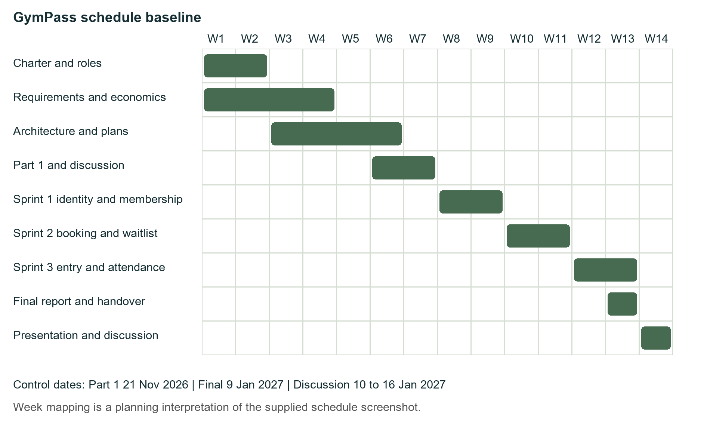

# 7 Cost management

Proposed section owner M1.

Estimate effort at JOD 5 per hour. The table separates planned work, risk reserve and extra sponsor reserve. The 64 risk hours are already included in the 448-hour team limit.

The planned 384 hours are: planning/design 144, checkpoint 16, login/membership 32, booking 40, attendance/reports 40, interface 32, tests 32, final report/handover 16 and presentation 32.

Earned value compares three numbers: PV is the work planned by a date, EV is the work accepted and AC is its actual effort cost. These need real records. Teaching example only: PV=800, EV=720 and AC=900 JOD. SV=EV-PV=-80 and CV=EV-AC=-180. SPI=EV/PV=0.90 and CPI=EV/AC=0.80 show delay and higher cost in this example. With BAC=2240, EAC=BAC/CPI=2800, ETC=EAC-AC=1900 and VAC=BAC-EAC=-560 JOD. These are not measured team results.

| Item | Hours | JOD |
| --- | --- | --- |
| Planned work | 384 | 1920 |
| Backup effort for known risks | 64 | 320 |
| Cost baseline | 448 | 2240 |
| Extra reserve controlled by sponsor | Not assigned | 224 |
| Maximum budget estimate |  | 2464 |

# 8 Resource management

Proposed section owner M1.

Each member has at most eight planned hours per week. In weeks 1–6, use six hours for planned tasks and keep two for risks. In week 7, split them four and four. In weeks 8–14, use eight planned hours. The totals are 384 planned hours and 64 reserve hours.

M1 covers planning and costs, M2 the pages, M3 the server and database, and M4 tests and recovery. This is a proposed allocation. Members should help each other and record exams or absences before changing the schedule.

# 9 Stakeholders and communication

Proposed section owner M1.

Students need simple booking. Instructors need their class list and a quick QR check. The sponsor/TA reviews scope and acceptance. University IT reviews hosting, login and recovery. Finance and privacy contacts review the records relevant to them.

Plan one short team meeting each week and a 30-minute TA review every two weeks. Write what is done, what comes next, time used, problems and decisions needed. Only record meetings and approvals that actually happen.

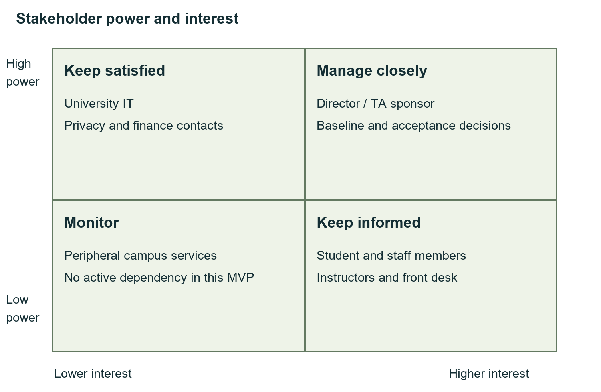

# 10 Risk management

Proposed section owner M4.

A risk is a problem that may happen. The table gives an estimated chance, effort and response. Check the triggers each week. Use the 64-hour risk reserve for agreed responses and ask the sponsor before using the extra reserve. The risk list should be updated when the team learns more.

| Risk | Owner | Chance / hours | Trigger and response |
| --- | --- | --- | --- |
| R01 | M1 | 30% / 24h | Less team time: review Must tasks first |
| R02 | M3 | 20% / 24h | Wrong seat count: block release and fix the transaction |
| R03 | M3 | 30% / 16h | Login setup fails: check the registered callback |
| R04 | M3 | 30% / 16h | Wrong waiting order: test time and ID ordering |
| R05 | M4 | 20% / 12h | Wrong absence count: test exact dates and job recovery |
| R06 | M3 | 20% / 16h | QR misuse: check signature, expiry and reuse |
| R07 | M2 | 30% / 16h | Phone layout fails: fix and retest at 360px |
| R08 | M4 | 30% / 16h | Host not ready: use local demo and request a test VM |
| R09 | M4 | 10% / 24h | Backup fails: restore a separate copy and investigate |
| R10 | M1 | 20% / 24h | Private data exposed: stop sharing and inform the TA/IT |
| R11 | M4 | 40% / 12h | Too few volunteers: recruit five users early |
| R12 | M2 | 30% / 16h | Screen/API mismatch: check the agreed response fields |
| R13 | M4 | 30% / 12h | Dependency warning: review its effect before upgrading |
| R14 | M1 | 20% / 16h | Team/schedule conflict: obtain the TA decision |

# 11 Quality management

Proposed section owner M4.

A task is done when the rule works, invalid requests are rejected, the screen gives a clear result and the notes match the code. Keep the existing tests and the minimum 70% backend statement coverage. Check capacity, load and backup recovery before a release.

For a defect, record the steps, expected result, actual result, owner and repeat check. A capacity or privacy failure stops release until fixed. Formatting helps people read the code; it does not prove that the program is correct.

# 12 Security and privacy

Proposed section owner M3.

Check the user's role and ownership on the server. Only the instructor assigned to a class may scan attendance for it. A valid QR alone is not enough: the suitable active plan and confirmed booking must also exist in the database. Rejected scans do not change attendance.

Passwords use salted scrypt hashes. A hash is saved instead of the password. Private session cookies identify the user. Origin and CSRF checks protect changes made through forms. Signup always creates a student; only the manager creates staff accounts. SQL values are passed separately from SQL text, and displayed text is escaped.

Initial passwords, live data and private settings stay outside Git. Older schema records remain compatible, but removed reception/security roles cannot sign in. HTTPS, official university identity and an independent security review remain work for a real pilot.

# 13 Tools and sourcing

Proposed section owner M3.

The app uses Node.js 24 and SQLite. Express handles URLs, qrcode creates the QR image, jsQR reads camera frames and jose supports the optional identity-provider login. c8 measures test coverage and Prettier formats source. package-lock.json records the installed versions.

The local project uses free tools and simulated payments. Install with npm ci --ignore-scripts. Check package licenses and security findings before upgrades. Runtime packages use MIT, except jsQR uses Apache-2.0; SQLite is public domain. Development tools have their own licenses. Hosting and identity-service choices need University IT input.

# 14 Configuration management

Proposed section owner M4.

Keep source, tests, report sources and diagrams in Git. Keep passwords, live databases, backups and private settings out. Make small changes and check them before saving an accepted version.

Version 1.2.2 is a readability update. It keeps the agreed behavior and database format. Save release evidence and back up data before future schema changes. The public project repository exists; student authorship and actual team contributions still need to be recorded by the team.

# 15 Construction plan

Proposed section owner M3.

Build and explain the program in this order: login, plans, timetable, booking, waiting list and QR attendance. src/server.js receives requests. src/service.js checks the gym rules. src/db.js creates the tables. Browser pages stay in public/.

The readability update gives the important variables clear names and breaks long HTML blocks into separate lines. Role checks, seat counting and booking eligibility are separate named steps. The CI workflow is included. This report records local verification; remote workflow results should be checked separately.

# 16 Test plan

Proposed section owner M4.

Tests use isolated databases and controlled time. They cover login, permissions, plan purchase, duplicate plans, capacity, booking times, cancellation and FIFO waiting order.

QR cases include an active booked student, no active plan, no booking, an unsuitable plan, wrong instructor, altered or expired code and repeated scans. Other checks cover cancellation by instructor/manager, 24-hour timetable hiding and removal of old generated data. No-show is recorded only after the class ends.

The current suite has 30 passing tests and 93.92% backend statement coverage. Coverage shows how much code ran during the tests; it is not a correctness percentage. The local 300-request test confirmed 20 bookings and queued 280 for 20 seats, with a p95 time of 894.84 ms. It uses one server and loopback HTTP, so it does not measure university-host or internet performance.

The encoder/decoder check confirms that jsQR reads the generated QR format. Browser checks cover valid and rejected scans, cancellation and language switching. Camera hardware, five real usability participants and the full independent browser, accessibility and security reviews remain pending.

# 17 Deployment plan

Proposed section owner M4.

For local use, install Node.js 24, open the project folder and run Start-GymPass.cmd, or npm ci --ignore-scripts followed by npm start. Open http://localhost:3000 after the ready message. First launch generates four local logins in accounts/initial-accounts.md. It creates no memberships or classes. Later launches keep saved records.

Docker files are included. Docker launch was not verified because the engine was unavailable in the preparation environment. For a university pilot, arrange hosting, HTTPS and trusted identity, run acceptance checks and agree a recovery plan. No university deployment is claimed.

If a release fails, stop new writes, keep the failed state, restore a known good backup and run the previous compatible version. Check integrity and record counts before reopening.

# 18 Support and operations

Proposed section owner M4.

The manager is the proposed first contact for account and plan problems. The instructor handles class QR checks. Confirm real support contacts and the proposed 06:00–23:00 service hours before a pilot.

The minute job finishes attendance, records no-shows, sends reminders and expires sessions. Daily backups and a separate restore check support recovery. Keep the runnable project, account files, setup guide, reports and test evidence together for handover. Recovery targets still need pilot measurements.

# 19 Maintenance plan

Proposed section owner M3.

Maintenance covers fixing faults, adapting to changes, preventing problems and improving useful features. Plan normal monthly updates and an urgent response to a serious security or data-loss fault.

The annual estimate is 160 hours: 48 for fixes, 40 for adaptation, 32 for prevention and 40 for improvements. At JOD 5 per hour, this is JOD 800. Review the estimate after the pilot. Remaining work includes hosting, official identity, independent checks and off-host backups. More server instances would need a suitable shared database and new concurrency tests.

# 20 Monitoring and closure

Proposed section owner M1.

At closure, compare the agreed scope with the working program and actual evidence. Confirm QR attendance, cancellation, class-end absence and duplicate-plan prevention. Record unresolved work, the accepted version and support instructions.

Each student must add their ID and real contribution. Use the EVM example for explanation until real effort records exist. Collect actual acceptance and approval before a university pilot. Do not treat a passing local test suite as completed user acceptance.

The main lessons are simple: check subscription and booking together, keep repeated scans safe, use the class end as the absence time, and update the notes whenever a rule changes.

# Appendix A Design diagrams

The main text explains the decisions in plain English. The diagrams show the same system in more detail. A box is a person, service or data record. An arrow shows a request or relationship. A state diagram shows how a booking changes. A sequence diagram shows the order of messages. Editable sources are in diagrams/.

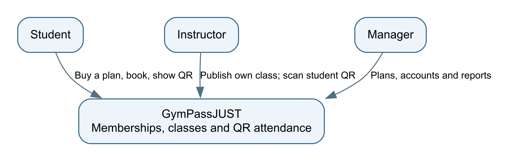

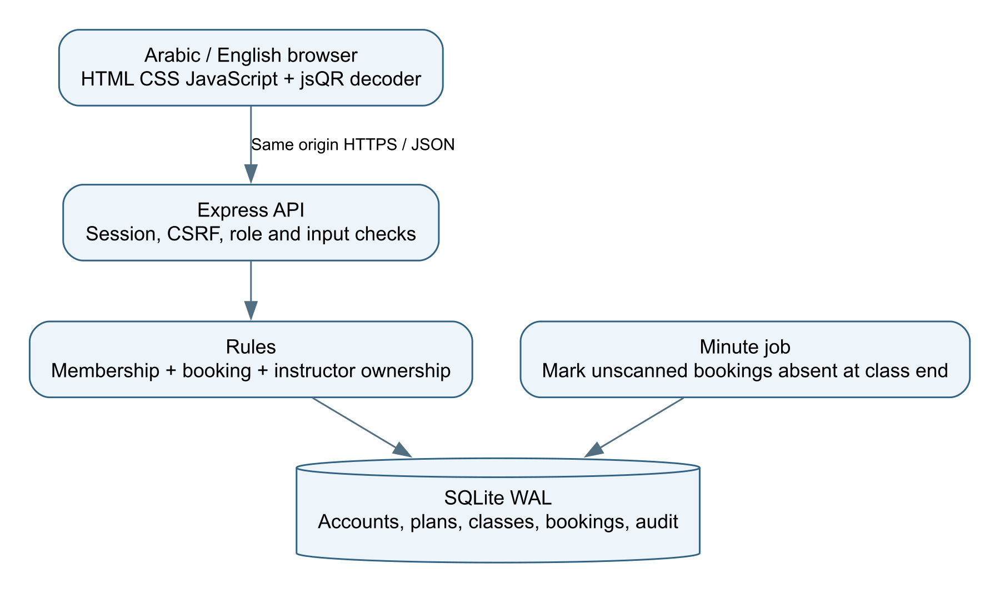

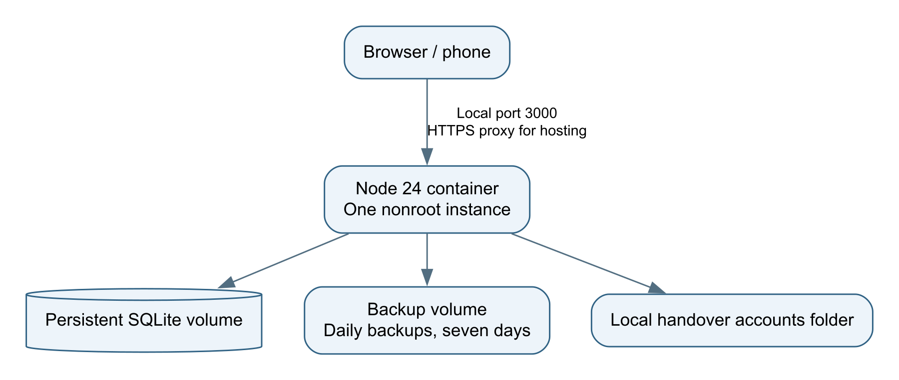

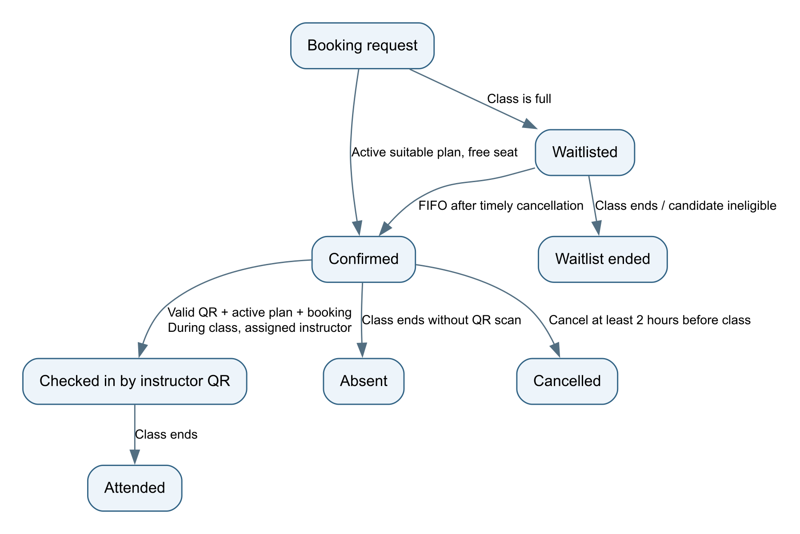

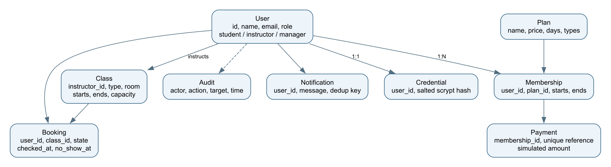

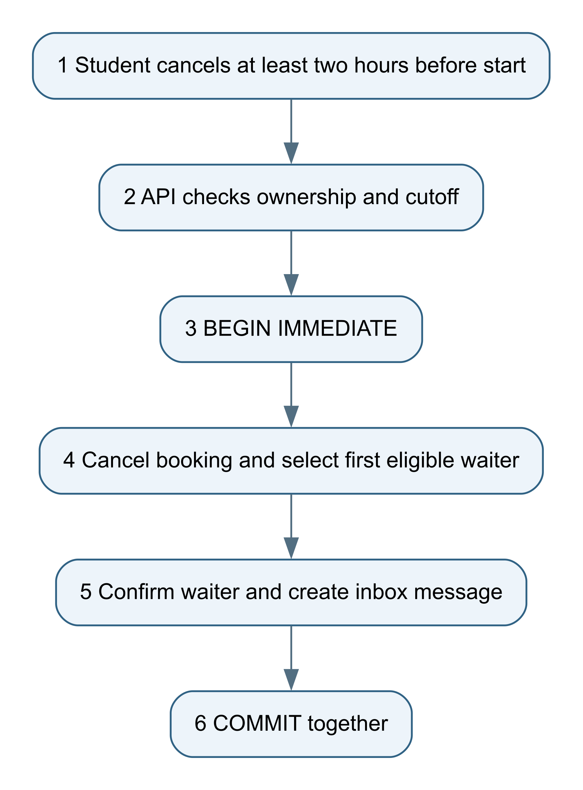

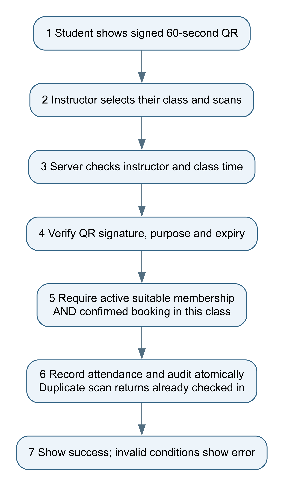

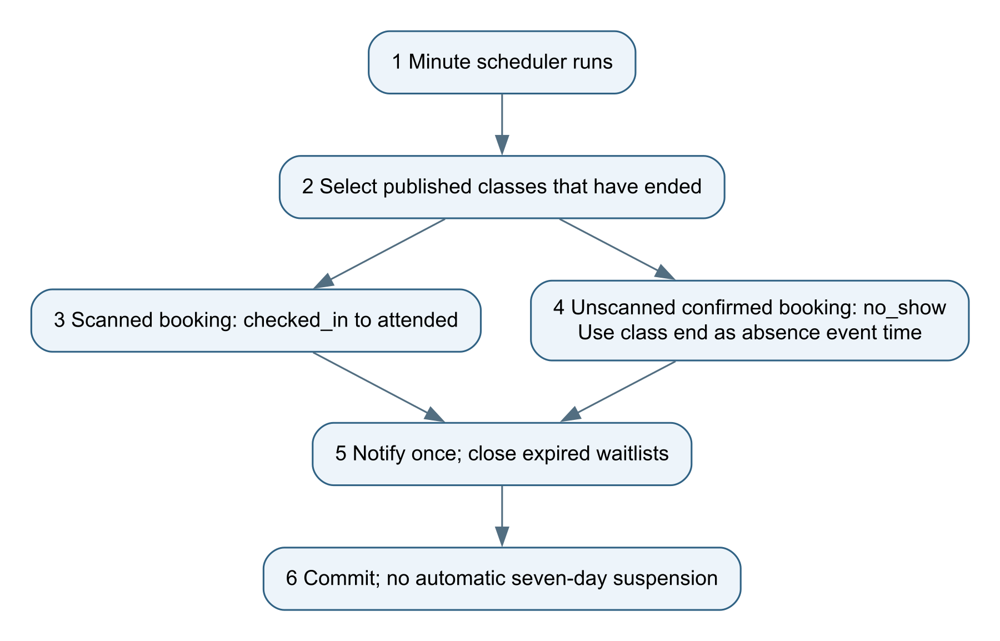

## Five main screen layouts

These wireframes show where the main information and buttons go. The final interface switches Arabic and English and supports phone screens.

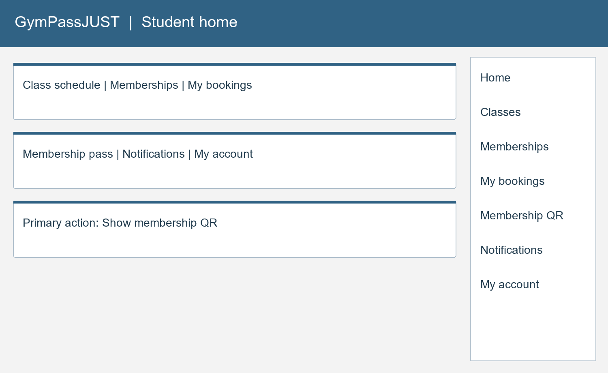

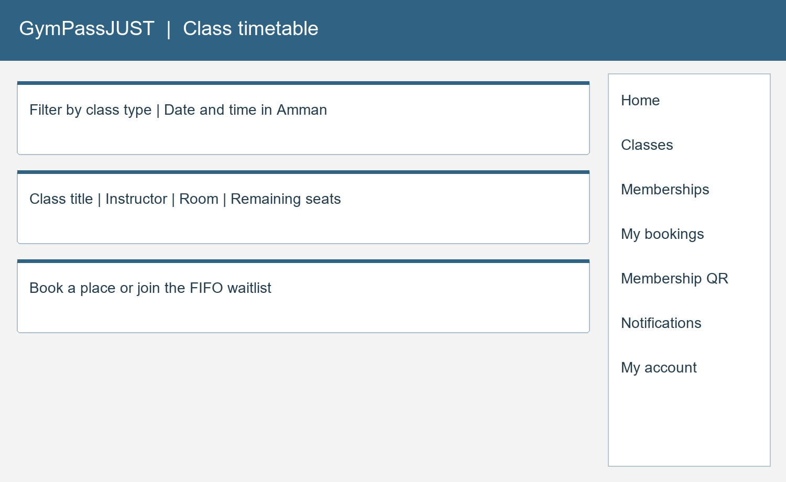

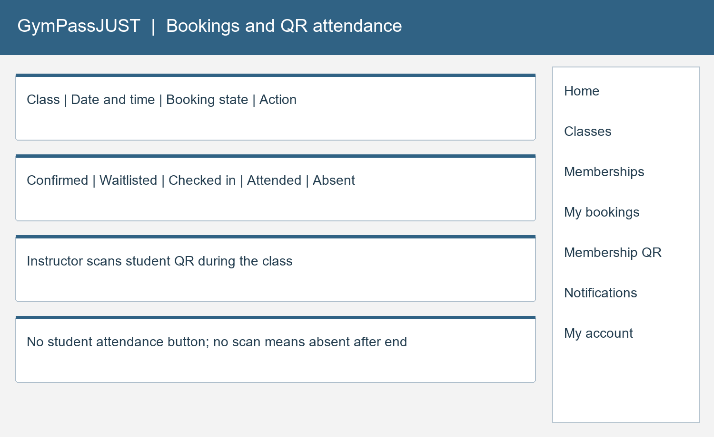

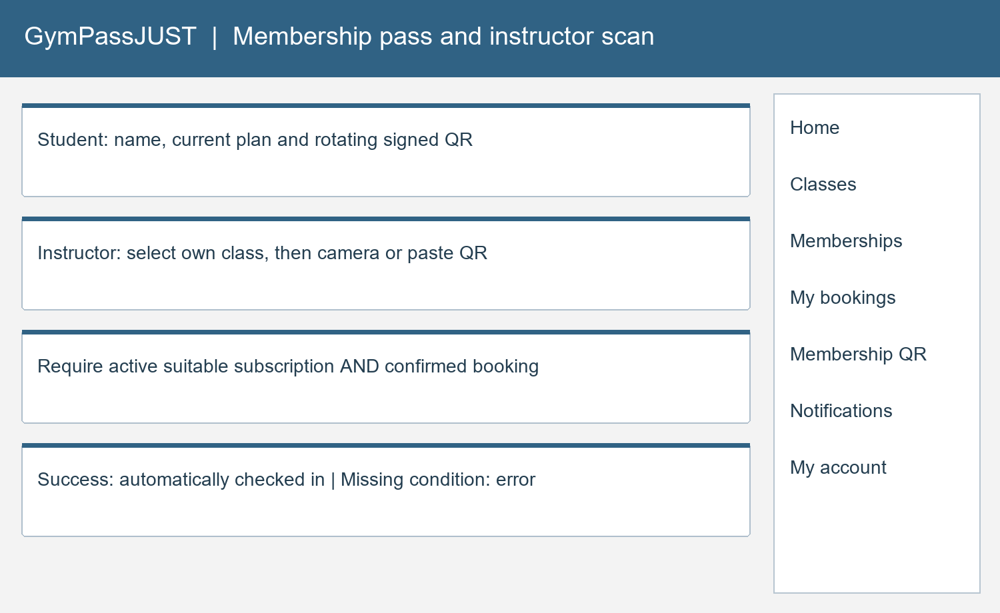

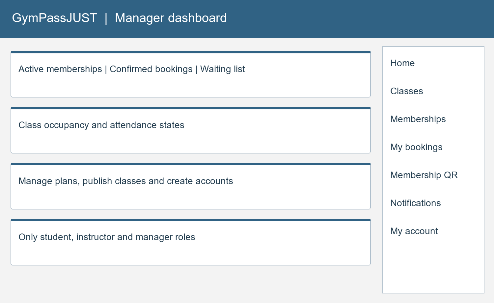

# Appendix B Assistance and remaining records

OpenAI Codex assisted with code, writing, diagrams and local checks. The team must review the work, understand it and record its own contributions. This disclosure follows textbook section 13.8. Missing interviews, approvals and user-study results are not presented as completed work.

# Appendix C References

1. Supplied SE440 textbook, CSP11 GymPassJUST, chapter 13, printed pages 161–170.
2. Supplied course assessment-schedule image, used for the report and discussion dates.
3. Node.js SQLite and testing documentation: https://nodejs.org/docs/latest-v24.x/api/sqlite.html and https://nodejs.org/docs/latest-v24.x/api/test.html.
4. Express and jose documentation: https://expressjs.com/ and https://github.com/panva/jose.
5. OWASP Top 10 2025: https://top10.owasp.org/2025/. The detailed review checklist is in security-checklist.md.

6. jsQR camera fallback, Apache-2.0: https://github.com/cozmo/jsQR.
