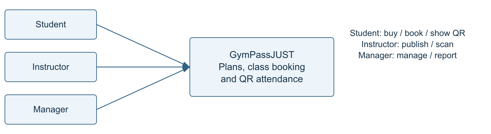
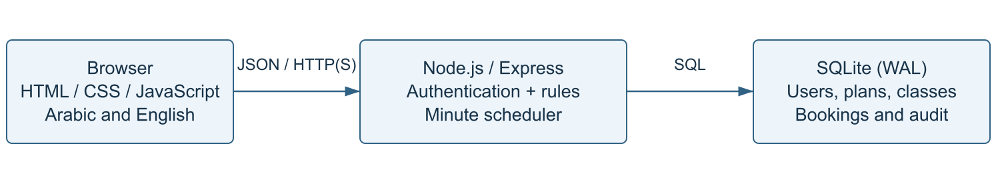
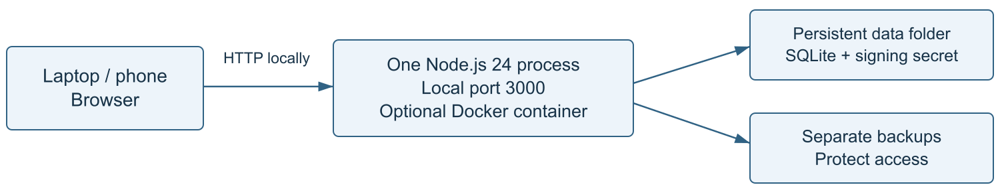
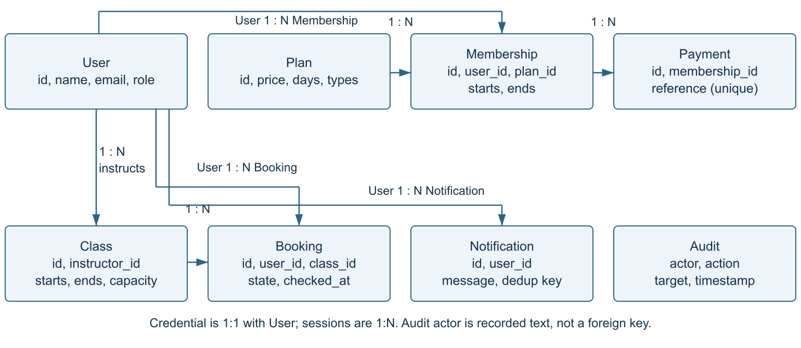
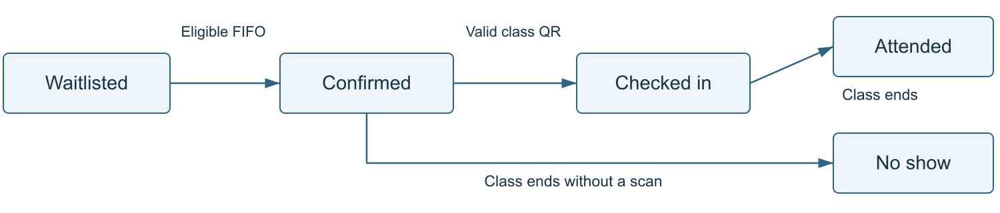
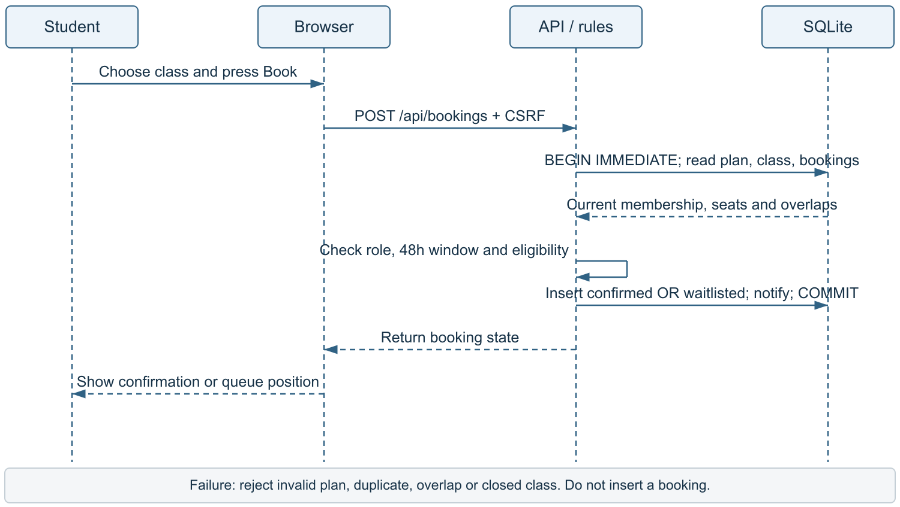
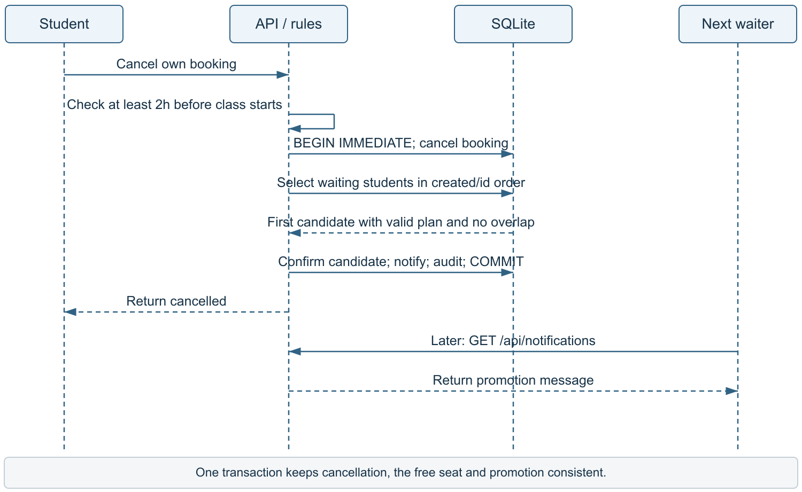
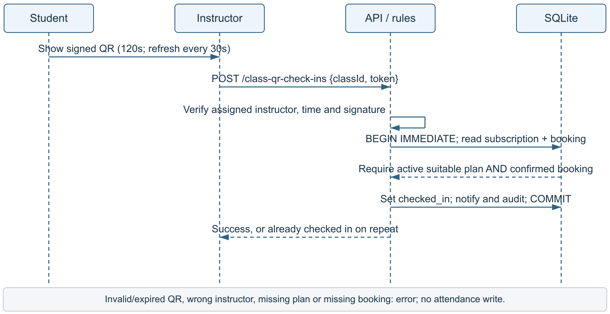
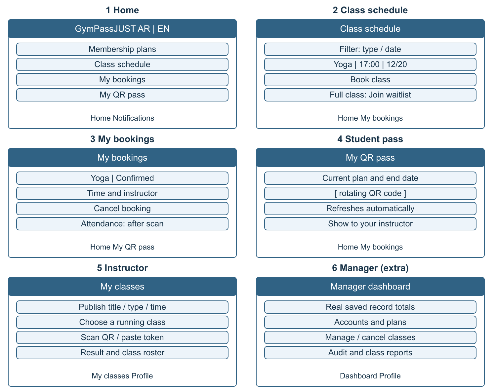

# GymPassJUST - Final Project Report

**Final Project Report** | SE440 CSP11 | Jordan University of Science and Technology

Report revision: 2 November 2026. System version: 1.2.2. Final submission: 9 January 2027.

A concise PMP using the supplied MiniBook structure. Sections 0-20 describe the current local system and remaining acceptance work. This is a team-review draft, not evidence of final course approval.

| Member | Proposed responsibility |

| --- | --- |

| M1 Asia Bassam Ahmad Quraia | Planning, requirements and costs |

| M2 Mai Qaseem Mohammad Al Rabayah | Arabic/English interface and usability |

| M3 Alaa Al Din Ziad Ali Al Tawalbeh | Server, database and booking rules |

| M4 Oday Mahmoud Mohammad Al Hajj | Tests, deployment and support |

M1-M4 identify planned owners throughout this report. Add student IDs and confirm actual section authors and contributions before submission. These assignments do not claim work performed by a student.

## 0 Project charter and business case

Planned section owner: M1.

The sports center needs one place to manage gym subscriptions, fair class bookings and attendance. A student buys a plan, books a class and shows a QR to the assigned instructor. The proposed sponsor is the Sports Center Director; the TA reviews the course deliverable. Neither sponsor acceptance nor university integration is claimed.

Success means no overbooking, FIFO promotion, valid class attendance checks and a clear bilingual interface. A proposed five-person usability test targets booking in at most three screens and under 30 seconds. This test is still pending.

The estimated baseline is JOD 2,240 (section 7). Assume annual benefits of JOD 1,800 less JOD 800 maintenance: net JOD 1,000. At 8% for three years, NPV = -2240 + 1000/1.08 + 1000/1.08² + 1000/1.08³ = **JOD 337.10**. These are planning assumptions, not actual savings.

## 1 Project overview

Planned section owner: M1.

Deliverables: working website and database; source and tests; Part 1 and final PDFs; user/run guides; diagrams and evidence. The first launch has four local accounts and three plans, with zero subscriptions or classes. Payments are simulated. Accounts are separate from official university accounts.

PMP = project management plan; FIFO = first in, first out; QR = signed rotating student pass; API = browser/server interface; NPV = today's value of future benefits. Source: github.com/3latw/GymPassJUST. References and AI disclosure appear on page 10.

## 2 Life cycle

Planned section owner: M1.

Use three short sprints: accounts/plans, booking/waitlist, then QR/reports. Demonstrate each slice and test its rules before the next one. Small increments suit four members and allow TA feedback. Update this plan through the change process in section 3.

## 3 Organization and governance

Planned section owner: M1.

Hold a weekly 20-minute meeting and record tasks, decisions and blockers. The feature owner implements; a different member reviews. M1 records changes; all affected owners estimate effort; the TA/sponsor decides material scope, cost or date changes. Do not promise an unapproved feature.

| Work / RACI | M1 | M2 | M3 | M4 |

| --- | --- | --- | --- | --- |

| Plan and requirements | A/R | C | C | C |

| Interface | A | R | C | C |

| Database and rules | A | C | R | C |

| Verification and handover | A | C | C | R |

R does the task, A is accountable, C is consulted. Notify the TA at each milestone (I). Working agreement: small real commits, no shared passwords in Git, peer review, and early notice of missed work. Record actual contributions rather than creating a fake history.

## 4 Scope, requirements and acceptance

Planned section owner: M1 + M3.

| ID / requirement | Simple acceptance check | Trace |

| --- | --- | --- |

| FR01-02: accounts and plans | Public signup creates only a student; only manager edits plans. | accounts / HTTP |

| FR03: simulated subscription | Reject the same active/queued plan; identical payment retry is safe. | current scope |

| FR04: publish classes | Instructor publishes own class; reject invalid time/capacity or room clash. | rules / HTTP |

| FR05: booking | Within 48h, require a suitable active plan; reject duplicate and overlap; no overflow. | rules / load |

| FR06-07: FIFO and cancellation | Student cancels at least 2h before start; first eligible waiter gets the place. | rules |

| FR08-09,15: QR attendance | Assigned instructor scans a valid pass during class; require BOTH plan and confirmed booking. | current scope / decoder |

| FR10,14: attendance history | At class end, scanned becomes attended; unscanned confirmed becomes no_show. | current scope |

| FR11-12: notifications / class cancellation | No duplicate notice. Assigned instructor or manager can cancel until class end. | current scope / HTTP |

| FR13,16: reports / audit | Manager totals come from saved records; students see only their own history. | HTTP / current scope |

Test names above refer to tests/accounts.test.js, http.test.js, rules.test.js, current-scope.test.js and qr-decoder.test.js. Full mapping: docs/requirements-traceability.md. The cancellation boundary and QR conditions are release acceptance rules.

**WBS:** 1 planning (requirements, cost, risks); 2 design (data, API, pages); 3 implementation (accounts, plans, booking, QR); 4 verification (rules, load, usability); 5 handover (backup, guides, acceptance). Each item has a named owner and a reviewable output.

**Scope limits:** no reception/security account, manual attendance, automatic seven-day suspension, real payment gateway or deployed university SSO. Cancelled/completed classes leave the timetable after 24 hours; history stays stored. A request outside scope needs an impact estimate and a recorded decision.

**Nonfunctional requirements:** enforce roles on the server; retain data on restart; Arabic RTL and English LTR; keyboard-operable pages at 360px; backend statement coverage at least 70%; no overflow at 100 concurrent bookings; p95 below 2s at 300. See sections 11-12 and 16 for evidence and pending checks.

## 5 Architecture and design

Planned section owner: M2 + M3.

Figure 1. C4 context: the three users and their main jobs.

Figure 2. C4 containers: a browser, one Node service and one SQLite database.

Figure 3. Deployment: verified local Node setup; Docker is an optional packaging path, not a claimed hosted deployment.

| Decision | Reason and trade-off |

| --- | --- |

| HTML/CSS/plain JavaScript | Simple pages that the team can read; no frontend framework is needed. |

| Node.js 24 + Express 5 | JavaScript on both sides; the server controls permissions and business rules. |

| SQLite + transactions + capacity trigger | Easy local setup and persistent storage; intended for one application instance. |

| Signed short-lived QR + server recheck | The QR identifies the student; live plan and booking checks decide attendance. |

Trust boundary: browser input is untrusted. Requests pass through authentication, CSRF and role checks before the service reads or changes data. Local HTTP is for demonstration; hosted camera access requires HTTPS.

### 5 continued: data and interfaces

Figure 4. Core entity relationships. Arrows point from one record to its many related records. Technical and legacy tables are omitted for clarity.

Figure 5. Main booking states. Students may also cancel before the cutoff; class cancellation closes remaining bookings. An unpromoted waitlist closes when the class ends.

| Main REST path (base /api) | Purpose / access |

| --- | --- |

| POST /auth/local/register, /auth/local/login | Create a student account or authenticate with email/password. |

| GET/POST /plans; POST /memberships | View plans; manager creates plans; student buys with Idempotency-Key. |

| GET/POST /classes; POST /classes/:id/cancellation | List/publish classes; assigned instructor or manager cancels. |

| POST /bookings; GET /bookings | Book a class; read own history. |

| POST /bookings/:id/cancellation | Student cancels own booking before the cutoff. |

| GET /membership-pass; POST /class-qr-check-ins | Student receives QR; instructor validates and records attendance. |

| GET /classes/:id/roster; GET /dashboard, /audit | Authorized roster; manager aggregates and audit. |

Full contract: docs/API.md. Auth routes are /auth/local/* (outside /api). Other listed paths use /api. JSON times are Unix milliseconds. Protected requests use session cookies; mutations require the correct Origin and CSRF token. Typical errors: 401 login, 403 access, 404 missing, 409 conflict, 422 invalid input, 429 limit.

### 5 continued: interaction sequences

Figure 6. Booking sequence: validate eligibility and allocate a seat or waitlist place in one transaction.

Figure 7. Cancellation/FIFO sequence: the first eligible waiting student receives the freed seat.

These lifeline diagrams show the successful paths. Rejected checks return an error without a partial update. The template's room/lab approval interaction is replaced by the gym's cancellation/FIFO interaction because this project does not have lab approvals.

### 5 continued: QR and screen design

Figure 8. Instructor QR sequence. Scanning is allowed from class start until just before class end, with no ten-minute limit.

Figure 9. Five required low-fidelity screens plus an extra manager screen. Labels are English for the report; the implemented interface switches Arabic/English.

The student pass lasts 120 seconds from issue and refreshes every 30 seconds. A valid repeated scan returns already checked in. At class end, the minute job finalizes attendance; absence time is the original class end even after downtime.

## 6 Schedule and estimates

Planned section owner: M1.

| Period / milestone | Output and dependency | Hours |

| --- | --- | --- |

| Weeks 1-2: initiation | Charter, scope and risks before design | 48 |

| Weeks 3-4: design | Data, API and wireframes before construction | 64 |

| Weeks 5-7: accounts / plans | Sprint 1; Part 1 report due 21 Nov 2026 | 80 |

| Weeks 8-10: booking / FIFO | Sprint 2; depends on users and plans | 88 |

| Weeks 11-12: QR / tests | Sprint 3; depends on confirmed bookings | 72 |

| Weeks 13-14: handover | Pilot, documentation, final report due 9 Jan 2027 | 32 |

Total planned work: 384h; reserve: 64h. These are course-week estimates, not a claim that the full timetable has elapsed. Part 1 discussion: 22-28 Nov; final discussion: 10-16 Jan; week-15 test date is pending. Estimates use small task breakdowns and weekly actual/remaining-hour review.

Critical path: approved scope → data/API design → accounts/plans → booking/FIFO → QR → verification → handover. UI can run in parallel after the API draft. Keep the reserve for identified risks; escalate a forecast date slip or more than 10% effort variance.

## 7 Cost and effort baseline

Planned section owner: M1.

| Item | Calculation | JOD |

| --- | --- | --- |

| Planned work | 384h × 5 JOD/h | 1,920 |

| Risk contingency | 64h × 5 JOD/h | 320 |

| Cost baseline (BAC) | 448h × 5 JOD/h | 2,240 |

| Management reserve | 10% of baseline; sponsor controlled | 224 |

| Total funding ceiling | Baseline + management reserve | 2,464 |

Each member has 8h/week for 14 weeks: 112h each, 448h total. Free/local tools are assumed; any paid hosting or new procurement needs approval. Track actual hours weekly. Credit completed tasks only after review/tests; multiply hours by the assumed rate for EVM.

**EVM teaching example, not measured team spending:** PV=800, EV=720, AC=900. SV=EV-PV=-80; CV=EV-AC=-180; SPI=.90; CPI=.80. With BAC=2240, EAC=BAC/CPI=2800; ETC=1900; VAC=-560. Replace the example with real earned-value data when available.

## 8 Resources and team development

Planned section owner: M1.

M1 leads planning; M2 owns the interface; M3 owns rules/data; M4 owns verification and handover. Each has 96 planned hours plus 16 reserve hours. Pair M2/M3 on API integration and M3/M4 on race and QR tests. Onboarding: run the README, use isolated test accounts, read the Arabic code guide and demonstrate one reviewed change. Rotate reviewers and rehearse all three account roles.

## 9 Stakeholders and communication

Planned section owner: M1.

| Stakeholder / power-interest | Communication and engagement |

| --- | --- |

| TA / proposed sponsor: high-high | Weekly short status and milestone demo; request scope/acceptance decisions. |

| Instructor / manager: medium-high | Review publishing, roster and QR flow at sprint demos. |

| Students: low-high | Recruit five volunteers for booking and QR usability tasks; collect coded feedback. |

| University IT: high-medium | Consult before hosting, real identity integration or a policy decision. |

## 10 Risk plan

Planned section owner: M1 + M4.

Estimate probability 0-1 and lost effort hours; prioritize probability × impact. Review weekly and when a trigger occurs. The groups below retain every ID in the detailed risk register. Expected exposure is 60.4h; reserve is 64h.

| Risk IDs / owner / exposure | Trigger and response |

| --- | --- |

| R01,14 / M1 / 10.4h | Capacity or course interpretation changes: protect Must scope and seek TA decision. |

| R02,04,05 / M3,M4 / 12h | Overflow, FIFO or end-time test fails: transaction/clock tests and immediate repair. |

| R03,06,10 / M1,M3 / 12.8h | Login/QR/security failure: deny invalid access, protect keys, review permissions. |

| R07,12 / M2 / 9.6h | RTL overflow or UI/API mismatch: device, keyboard and integration checks. |

| R08,09,11 / M4 / 12h | Hosting, restore or volunteer delay: local demo, restore drill, recruit early. |

| R13 / M4 / 3.6h | Audit/version alert: inspect advisory and test isolated upgrades. |

## 11 Quality management

Planned section owner: M4.

Definition of Done: acceptance rule demonstrated, relevant tests pass, peer review complete, API/docs current, and no known blocking defect. Targets: ≥70% backend statement coverage, zero overbooking, p95 &lt;2s at 300 concurrent bookings, no role bypass, readable Arabic/English at 360px. M4 records evidence; the owner fixes defects. Usability, full device/accessibility checks and independent acceptance remain pending.

## 12 Security and privacy

Planned section owner: M3 + M4.

| Threat | Control and verification |

| --- | --- |

| Impersonation / account guessing | Salted scrypt hashes, request limits and server sessions; account/HTTP tests. |

| Role bypass / forged request | Server-side role/ownership checks, Origin + CSRF, prepared SQL and escaped text. |

| Forged, expired or reused QR | Signature/purpose/expiry plus live plan/booking checks; duplicate scan is safe, not a second attendance event. |

| Private data or database loss | Own-record access, protected files, backup/restore and no credentials/database in public Git. |

Collect only needed account and booking data. Use synthetic data for tests and coded usability notes. Proposed retention and deletion rules need university approval; do not invent a legal retention period. Hosted HTTPS and a security review are required before real deployment.

## 13 Procurement and tooling

Planned section owner: M4.

Build the gym rules; reuse maintained infrastructure. Node/Express, qrcode, jsQR and jose use MIT licenses; c8 uses ISC and SQLite is public domain. Check installed LICENSE files before redistribution. Use GitHub for source; Docker is optional. No paid service is purchased. Keep attribution, the lockfile and the upstream license files; avoid adding a payment/identity service without approval.

## 14 Configuration and release management

Planned section owner: M3 + M4.

Configuration items: source, schema/migrations, lockfile, tests, report/diagram sources, guides and evidence. Use short branches and reviewed real commits; tag a release only after checks. Baseline: v1.2.2 with dated evidence. Keep .env, accounts, signing keys, live data and backups out of public Git. A report-only revision does not change the application version. Retain the last working package and a database backup for rollback.

## 15 Construction and integration

Planned section owner: M2 + M3.

Implement accounts/plans, then booking/FIFO, then QR/manager reports. Use descriptive JavaScript names and small functions. Keep validation and state changes in the service rather than trusting the page. Review each change, run syntax/unit/HTTP checks, and integrate a passing slice. The proposed CI quality gate is the same checked-in test/coverage command; do not claim a hosted pipeline run without its record.

## 16 Verification and validation

Planned section owner: M4.

Use isolated databases and an injected clock. Test boundaries, invalid inputs, equivalence groups and concurrent requests. Levels: rule/unit, database/API integration, browser role flows and planned user acceptance. Entry: install works, contract is stable and fixtures are separate. Exit: all automated tests pass, no blocking defects and acceptance evidence is reviewed.

| Check / source | Observed local result on 2 Nov 2026 |

| --- | --- |

| Automated suite / evidence/test-results.txt | 30 passed. Backend statements 93.92%; branches 86.32%. |

| Capacity / evidence/load-results.json | 100 requests: 20 confirmed + 80 waiting; zero errors; p95 527.36ms. |

| Capacity / same file | 300 requests: 20 confirmed + 280 waiting; zero errors; p95 894.84ms. |

| Fresh package / fresh-package-smoke.json | Four initial logins; database integrity OK; saved credentials survive restart. |

| Browser / simple-browser-checks.json | Student booking, language switch, instructor QR and class cancellation checked. |

Load setup: Windows, Node 24.14.1, i7-8650U, one process, disk SQLite/WAL, loopback HTTP, pre-created sessions, no WAN/TLS/proxy. Results are not a hosted capacity promise. QR failure tests include missing plan, missing booking, wrong instructor, invalid/expired token and repeat scan.

Hardware camera scanning, five-person usability, full browser/WCAG checks and independent security acceptance are pending. Log each defect with steps, expected/actual result, severity and owner; fix blockers, rerun the relevant checks and retain evidence. Do not fill in participant results that did not happen.

## 17 Deployment and transition

Planned section owner: M4.

Run Node.js 24.10+ within v24, install with npm.cmd ci, then npm.cmd start; open http://localhost:3000. Start-GymPass.cmd automates the local launch. First launch saves local handover logins in accounts/. SQLite persists in data/; keep both folders private. Docker files provide an optional persistent-volume setup, not a verified production launch.

Before a pilot: back up the database and configuration, verify restore/integrity in a separate folder, rehearse migrations with a copy, check the three roles, HTTPS and camera. Roll back by stopping writes and restoring the previous app plus matching backup. Obtain sponsor/TA go-live approval; it has not been recorded.

## 18 Operations and support

Planned section owner: M4.

Proposed pilot support: weekdays 09:00-17:00, with M4 as first contact and M3 for data/rules incidents. Target acknowledgement: 1h for data loss/blocked access, one working day for a minor defect; these are proposals, not agreed service levels. Monitor startup, scheduler errors, failed backups, access errors and disk space. Keep minimal logs without passwords or QR tokens. Use README, the code guide and a three-role demonstration for handover.

## 19 Maintenance

Planned section owner: M3 + M4.

Proposed yearly effort: 48h corrective + 40h adaptive + 32h preventive + 40h improvements = 160h, or JOD 800 at the assumed rate. Review issues/dependencies monthly; prioritize a security or data-integrity fix immediately, then test before release. Keep technical debt and feature requests in the backlog. This is an estimate, not a support contract.

## 20 Monitoring, control and closure

Planned section owner: M1.

Track completed/remaining hours, milestones, risks and issues weekly. Use the section-7 EVM example only for explanation until real figures exist. Change record: manual/reception attendance replaced by instructor QR; duplicate-plan purchase blocked; class cancellation and 24h timetable hiding added. These match the current scope.

Open items: real usability sessions, hardware camera/device checks, external security/hosting review, student IDs/actual authors, TA acceptance and real contribution records. Close only when blockers are resolved, sponsor/TA acceptance is recorded, guides/backups are handed over and lessons are discussed. No final acceptance is claimed.

### Appendix A: AI assistance disclosure

Tool: OpenAI Codex. Purpose: coding/refactoring help, draft documentation, diagrams and automated checks. Changes in this revision: shorter English, ten-page layout, gym-specific sequences and wireframes, corrected QR/cancellation wording and dated evidence. Students must review, run, understand and correct the work and record their actual contributions. AI use is disclosed as required by the supplied template.

### References and use of the template

[1] Supplied TemplateCSP_MiniBook.pdf: PDF pages 8-12 (PMP 0-20, deliverables, authors and AI), page 20 (design figures). [2] Supplied SE440 submission-schedule screenshot: 21 Nov 2026 and 9 Jan 2027. [3] Supplied CSP11 project brief and the user's later gym rules. [4] Project README, docs/API.md, requirements-traceability.md and evidence/. The template's UniRoom rooms/labs are examples; this report applies its structure to GymPassJUST.
