# GymPassJUST planning report

SE440 CSP11 | University Sports Center Membership and Class Booking

Jordan University of Science and Technology

1 November 2026 | English report

Part 1 target: 21 November 2026. Sections 0–16 contain the plan; sections 17–20 are outlines.

The system helps members buy a membership, book a sports class and enter with a QR pass. The main text is the team explanation. Appendix A holds the detailed diagrams. Proposed roles are listed in section 3; student IDs, actual authors and final approval still need confirmation.

[TOC]

# 0 Project charter and business case

Proposed section owner M1.

GymPassJUST helps the university sports center manage memberships, class bookings and entry. It replaces paper cards and informal queues. The proposed sponsor is the Sports Center Director, represented by the TA for the course.

Our goal is a working local system with fair booking rules. A class must never exceed its capacity. A free seat should go to the first eligible waiting member. The final target is a booking journey under 30 seconds and no more than three screens, checked with five users.

The team has four members. The planned limit is 4 x 8 hours x 14 weeks = 448 hours. At an estimated JOD 5 per hour, the cost baseline is JOD 2,240. This is a planning estimate, not money already spent.

The business example assumes JOD 1,800 benefit per year and JOD 800 yearly maintenance. That leaves JOD 1,000 per year. With an 8% discount rate over three years: NPV = -2240 + 1000/1.08 + 1000/1.08^2 + 1000/1.08^3 = JOD 337.10. NPV means the value of future benefits after allowing for time. These benefit estimates need sponsor approval.

# 1 Introduction and project overview

Proposed section owner M1.

This report explains what GymPassJUST does, how we plan the work and how we check the result. The project follows CSP11 in the supplied SE440 textbook. The interface switches between Arabic and English, including page direction. The reports are English.

The supplied schedule gives Part 1 on 21 November 2026 and the final report on 9 January 2027. Final discussions are 10–16 January. The chapter has different checkpoint dates, so the latest instructor notice should be kept with the submission.

Normal startup creates four local access accounts and three plan options, with no automatic memberships or classes. Counts use saved registrations and purchases. The 1,500-member fixture exists only in isolated automated tests. Legacy fixture data is removed after a database backup; registered accounts, purchased memberships and manually published classes are preserved. Payments are simulated. Local email/password accounts are real and saved in SQLite; they are separate from official university accounts. The original brief assumes 5–7 students; this plan uses the four-member team provided by the user.

# 2 Development approach and life cycle

Proposed section owner M1.

We use fixed submission dates and short development cycles called sprints. First we plan the requirements and design. Then each sprint adds a working part and its tests.

Sprint 1 covers login, memberships and the timetable. Sprint 2 covers booking, waiting lists and cancellation. Sprint 3 covers instructor QR attendance, class-end absence and reports. Before adding the next part, we check that the current part works.

# 3 Project organization and governance

Proposed section owner M1.

The duties below are proposed. Each person must confirm their actual work before submission. M1–M4 match the names in team.json. Student IDs still need to be filled.

| Member | Main duty |
| --- | --- |
| M1 Asia Bassam Ahmad Quraia | Plan, requirements and cost |
| M2 Mai Qaseem Mohammad Al Rabayah | Arabic pages and usability |
| M3 Alaa Al Din Ziad Ali Al Tawalbeh | Server, database and booking rules |
| M4 Oday Mahmoud Mohammad Al Hajj | Tests, backup and deployment |

RACI makes responsibilities clear. R does the task, A approves the result, C is consulted and I is informed. These are planned assignments.

| Task | M1 | M2 | M3 | M4 | Sponsor |
| --- | --- | --- | --- | --- | --- |
| Requirements | R/A | C | C | C | C |
| Design | I | C | R/A | C | I |
| Interface | I | R/A | C | C | I |
| Testing | I | C | C | R/A | I |
| Scope change | R | C | C | C | A |

Meet weekly, record blockers and review changes before merging them. M1 takes unresolved scope or deadline issues to the TA. The sponsor approves scope and final acceptance. Actual authors and student contributions must come from real team work.

# 4 Scope and requirements management

Proposed section owner M1.

The final user request is the working scope for this version. It changes the textbook baseline: only students, instructors and the manager remain. The instructor scans the student QR for a selected class. The server checks subscription AND booking, then records attendance in one transaction. Manual attendance buttons and separate security/reception roles are removed.

The instructor can scan at any time from class start until class end. A booked student who is not scanned becomes absent after class end. A duplicate scan reports that the student was already checked in and does not add another attendance record. This revision does not apply an automatic seven-day suspension. The course instructor should review these documented changes against CSP11.

| ID | Current behavior | Check |
| --- | --- | --- |
| FR-01 | Email/password login; student, instructor and manager roles | Public signup always creates a student |
| FR-02 | Manager defines membership plans | Validate price, duration and included types |
| FR-03 | Simulated plan purchase | Block the same plan while active or queued; an identical payment retry is safe |
| FR-04 | Manager or instructor publishes classes | Instructor publishes only under their own ID; check room/time clashes |
| FR-05 | Book within 48 hours with a suitable active plan | Never exceed capacity or accept a duplicate/overlapping booking |
| FR-06 | FIFO waiting list | Confirm the first eligible waiter when a place is cancelled |
| FR-07 | Cancel at least two hours before class | Accept the exact cutoff; reject a later cancellation |
| FR-08 | Student shows a rotating signed QR | The instructor scans it for a selected class |
| FR-09 | QR automatically records class attendance | Require BOTH an active suitable plan AND a confirmed class booking |
| FR-10 | No QR scan means absent after class end | No ten-minute deadline; automatic seven-day suspension is outside this revision |
| FR-11 | In-app confirmations and reminders | Deduplicate messages |
| FR-12 | Assigned instructor or manager cancels before class end | Cancel remaining reservations and notify students; hide after 24 hours |
| FR-13 | Manager views membership and booking totals | Use saved records; detailed class states remain in the roster |
| FR-14 | Student sees booking and attendance states | Show only their own records |
| FR-15 | Instructor verifies at the class door | Security/reception accounts were removed by the user |
| FR-16 | Manager views the audit log | Record purchases, publication and successful QR attendance |

Buying a plan that is already active or queued is rejected on the server and its card is marked Subscribed. A new purchase of the same plan becomes available after expiry. Other plans may still be purchased. Booking opens 48 hours before start; student cancellation closes two hours before start. An assigned instructor or manager may cancel a class until its end. Cancelled classes disappear from the timetable 24 hours after cancellation, and completed classes 24 hours after their end. Booking history remains saved. Waiting-list order and seat capacity are protected by a database transaction.

| Quality target | Evidence |
| --- | --- |
| 95% of booking requests under two seconds with 300 members | Local result: 689.93 ms. Hosting test still needed |
| 99.5% availability during opening hours | Pilot monitoring still needed |
| HTTPS, role checks, password hashes and signed QR | Role/QR tests pass; real HTTPS hosting still needed |
| No high or critical security findings | Dependency and local checks done; independent review still needed |
| Only needed personal data; remove it after retention ends | 365-day cleanup after the latest membership end; policy review needed |
| WCAG 2.1 AA accessibility | Labels and keyboard support added; full review still needed |
| Four main browsers and phones from 360px | In-app Chromium tested; other browsers still needed |
| At least 70% backend statement coverage | Measured 93.89% |
| Daily backup and a successful restore | Local restore passed; off-host backup still needed |
| One deployment command or pipeline | Docker files supplied; Docker engine was unavailable |

# 5 Architecture and design

Proposed section owner M3.

The browser uses plain HTML, CSS and JavaScript. The Node.js server checks every request. SQLite stores the accounts, plans, classes, bookings, notifications and audit log. The interface switches between Arabic and English.

The student opens Membership pass. The server signs a QR token valid for two full minutes from issuance; the displayed card refreshes every 30 seconds and when returning to the browser tab. The instructor selects their own class and scans this token. The server checks the instructor, class time, token signature, active suitable plan and confirmed booking. Only then does it change the booking to checked_in. At class end the minute job changes it to attended; unscanned confirmed bookings become no_show. Absence uses the original class end time even after downtime.

The camera uses the browser decoder where available and a local jsQR fallback otherwise. No image is sent to a third party. An instructor can also paste the QR text during a classroom demonstration. Camera permission and a secure browser origin are needed for a real camera session.

Local accounts use salted scrypt password hashes and private session cookies. The manager creates staff accounts; students cannot choose a staff role. SQLite supports this one-server project; more application instances require a shared database and new tests.

| API | Purpose | Role |
| --- | --- | --- |
| GET /api/membership-pass | Create student QR | Student |
| POST /api/class-qr-check-ins | Validate QR and automatically check in | Assigned instructor |
| POST /api/memberships | Buy a non-duplicate plan | Student or manager |
| POST /api/classes | Publish a class | Instructor or manager |
| GET /api/bookings | Read own booking/attendance history | Signed-in user |
| GET /api/dashboard | Read totals | Manager |

# 6 Schedule management

Proposed section owner M1.

The schedule below uses the supplied course screenshot. The week dates are a planning interpretation of that screenshot.

| Weeks | Main work | Control date |
| --- | --- | --- |
| 1–6 | Charter, requirements, design and plans | Part 1: 21 Nov 2026 |
| 7 | Part 1 discussion and feedback | 22–28 Nov 2026 |
| 8–9 | Login, membership and timetable | Sprint 1 review |
| 10–11 | Booking, waiting list and cancellation | Sprint 2 review |
| 12–13 | Attendance, QR, reports and final checks | Final: 9 Jan 2027 |
| 14 | Presentation and discussion | 10–16 Jan 2027 |
| 15 | Individual laboratory test | Instructor to confirm |

The main dependency path is requirements, design, membership, booking, attendance and final testing. This is the critical path: a delay in one of these can delay the final result. Review progress weekly. A projected delay of more than three days should be discussed early; the one-week variance target does not give permission to submit late.

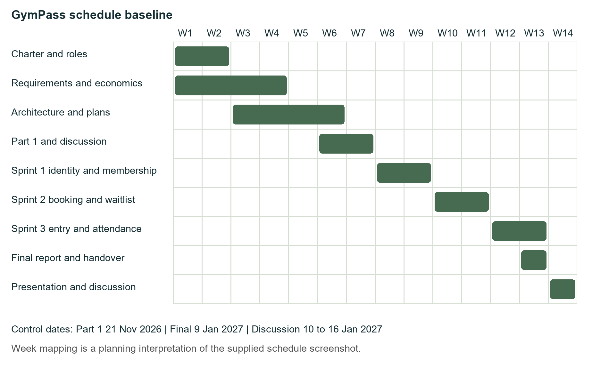

# 7 Cost management

Proposed section owner M1.

The estimate uses hours instead of actual payments. The hourly rate is an assumed JOD 5.

| Item | Hours | JOD |
| --- | --- | --- |
| Planned work | 384 | 1920 |
| Backup effort for known risks | 64 | 320 |
| Cost baseline | 448 | 2240 |
| Extra reserve controlled by sponsor | Not assigned | 224 |
| Maximum budget estimate |  | 2464 |

The work estimate is planning/design 144h, checkpoint 16h, login/membership 32h, booking 40h, attendance/reports 40h, interface 32h, tests 32h, final report/handover 16h and presentation 32h. The 64h risk reserve is already inside the 448h limit.

Earned value compares the plan with accepted work. PV is the value planned by a date. EV is the value of work accepted. AC is the cost of effort actually used. These must come from actual records.

Teaching example only: PV=800, EV=720 and AC=900 JOD. Schedule difference SV=EV-PV=-80. Cost difference CV=EV-AC=-180. SPI=EV/PV=0.90 and CPI=EV/AC=0.80. Both below 1 show that the example is behind plan and over cost. With BAC=2240, EAC=BAC/CPI=2800, ETC=EAC-AC=1900 and VAC=BAC-EAC=-560 JOD. These are not claimed project actuals.

# 8 Resource management

Proposed section owner M1.

Each member has a planned maximum of eight hours a week. In weeks 1–6, each person uses six planned hours and keeps two for risks. In week 7, each uses four planned hours and keeps four. In weeks 8–14, each has eight planned hours. This gives 384 planned team hours and 64 reserve hours.

M1 practices requirements and cost calculations. M2 practices HTML/CSS/JavaScript and Arabic layout. M3 practices Node.js, SQL and login. M4 practices testing and recovery. Current skill levels have not been measured. M4 backs up M3 on tests and database work; M2 and M4 review usability together. Record exams and absences in the availability calendar and adjust the plan early.

# 9 Stakeholders and communication

Proposed section owner M1.

The sponsor/TA reviews scope and acceptance. Members need easy, fair booking. Instructors need their class roster and a fast QR attendance check. University IT needs safe login, hosting and recovery. Finance and privacy contacts review the records relevant to their work.

Hold one short team meeting per week and request a 30-minute TA review every two weeks. A status note says what was accepted, what comes next, hours used, blockers and decisions needed. Record real decisions; no past meetings are assumed.

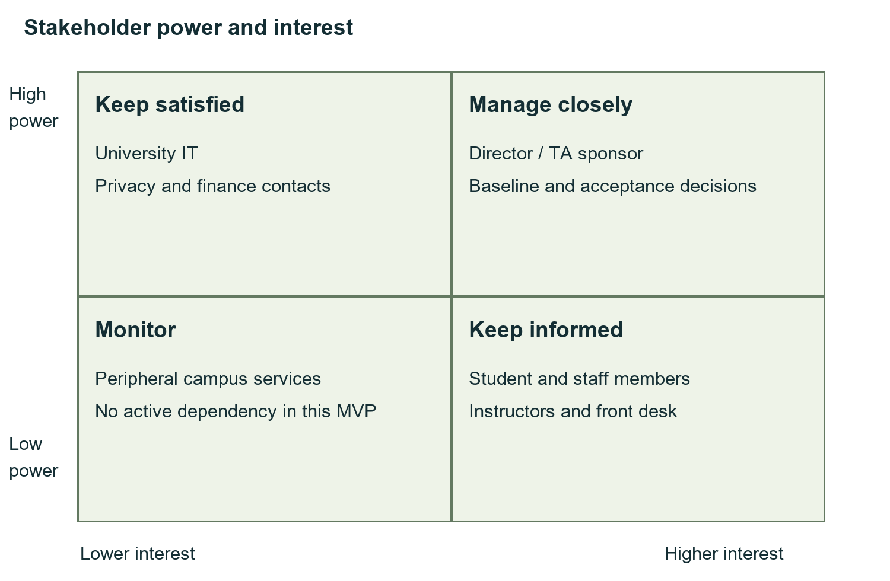

# 10 Risk management

Proposed section owner M4.

A risk is something that might go wrong. The table gives an estimated chance and the hours needed if it happens. The response says what to do when its trigger appears.

| Risk | Owner | Chance / hours | Trigger and response |
| --- | --- | --- | --- |
| R01 | M1 | 30% / 24h | Less team time: review Must tasks first |
| R02 | M3 | 20% / 24h | Wrong seat count: block release and fix the transaction |
| R03 | M3 | 30% / 16h | Login setup fails: check the registered callback |
| R04 | M3 | 30% / 16h | Wrong waiting order: test time and ID ordering |
| R05 | M4 | 20% / 12h | Wrong absence count: test exact dates and job recovery |
| R06 | M3 | 20% / 16h | QR misuse: check signature, expiry and reuse |
| R07 | M2 | 30% / 16h | Phone layout fails: fix and retest at 360px |
| R08 | M4 | 30% / 16h | Host not ready: use local demo and request a test VM |
| R09 | M4 | 10% / 24h | Backup fails: restore a separate copy and investigate |
| R10 | M1 | 20% / 24h | Private data exposed: stop sharing and inform the TA/IT |
| R11 | M4 | 40% / 12h | Too few volunteers: recruit five users early |
| R12 | M2 | 30% / 16h | Screen/API mismatch: check the agreed response fields |
| R13 | M4 | 30% / 12h | Dependency warning: review its effect before upgrading |
| R14 | M1 | 20% / 16h | Team/schedule conflict: obtain the TA decision |

Expected effort is chance x hours. For example, R01 is 0.30 x 24 = 7.2h. The fourteen risks total 60.4h, rounded to a 64h reserve. These are estimates. Review risks weekly and record reserve use. A problem that has already happened goes in the issue log.

# 11 Quality management

Proposed section owner M4.

A feature is done when its rule works, its rejection cases are tested, the Arabic screen gives a clear result and the documentation is updated. A release also needs coverage, load and restore evidence. Do not lower a test threshold to make a failed check pass.

Review the code for correct behavior, readable structure, access checks and slow queries. A capacity or privacy failure blocks release. A defect record needs steps, expected result, actual result, owner and a repeat test. Source formatting uses Prettier. It makes code easier to read; it does not prove the code is correct.

# 12 Security and privacy

Proposed section owner M3.

The server checks the role and ownership on every protected route. A student cannot scan attendance for themselves; only the instructor assigned to the selected class can do it. A valid QR alone is not enough: the active suitable subscription and confirmed class booking must both exist in SQLite. Unknown, modified, expired, unbooked or unsubscribed QR attempts leave attendance unchanged.

Passwords are saved as salted scrypt hashes. Session cookies are HttpOnly. Changes require a matching Origin and CSRF token. Login/signup limits are persistent. Text is escaped and SQL values use prepared statements. The four initial handover passwords are kept outside Git and public web files.

The database keeps the older schema tables for a non-destructive upgrade. Old security/reception accounts cannot log in or access APIs and are omitted from the handover file. No passwords or live student data are placed in reports. HTTPS, university SSO and an independent security review remain pilot activities.

# 13 Tools and sourcing

Proposed section owner M3.

The runtime uses Node.js 24, Express 5.1.0 for routes, jose 6.2.1 for identity-token checks and qrcode 1.5.4 for QR images. These libraries use MIT licenses. SQLite is public domain. c8 10.1.3 measures coverage and Prettier 3.6.2 formats source; these are development tools. Their licenses are ISC and MIT respectively.

The application uses free local tools and simulated payment. There is no paid service in the local plan. Exact package versions are in package-lock.json. Install with npm ci --ignore-scripts. Review library licenses and security warnings before an upgrade. Production installs leave out development tools. Actual cloud/VM and identity service choices need University IT input.

# 14 Configuration management

Proposed section owner M4.

Keep source, schema, seed, tests, report sources and diagrams in Git. Keep passwords, private environment files, live databases and backups out of the repository. Use short branches, review changes and merge after checks pass.

Version 1.2.1 identifies this local package. Use a patch version for a compatible fix, a minor version for a compatible feature and a major version for a breaking change. Save the accepted version and its evidence. Back up the database before a schema change. A real team repository and actual student contributions still need to be supplied; generated commits are not student work history.

# 15 Construction plan

Proposed section owner M3.

Build in this order: login, membership, timetable, booking/waiting list, attendance/QR and reports. Keep the browser code separate from server rules and database setup. Use shared server rules for the screens and tests.

Each sprint ends with a working demo and checks for its rules. The supplied CI workflow installs fixed packages, checks JavaScript, runs tests and the load test, checks runtime dependencies and saves evidence. It has not run in a remote team repository. The local commands were run.

# 16 Test plan

Proposed section owner M4.

Tests use isolated databases and controlled clocks. They check the booking window, capacity, waiting order, duplicate payments, duplicate subscriptions, local login and staff-role restrictions.

QR tests cover an active booked student, an inactive subscription, a student without a confirmed booking, a plan excluding the class, the wrong instructor, a modified/expired QR and a duplicate scan. Attendance remains open after the first ten minutes and until class end. Unscanned bookings become absent only after the end. The scheduler uses the class end as the event time and sends the absence message once.

The current suite reports 30 passing tests and 93.89% backend statement coverage. Coverage measures executed code, not a percentage of correctness. The encoder/decoder round-trip test verifies that jsQR reads the QR output. Real browser checks used the instructor form to confirm valid attendance and reject an active unbooked student and an expired membership. Actual camera hardware was not exercised.

The new local 300-request burst measured 689.93 ms p95, with 20 confirmed and 280 waiting for 20 seats. The test uses pre-created sessions, one process and loopback HTTP; it is not a university-host performance claim. Independent usability, the full browser/WCAG matrix and security review remain open.

# 17 Deployment plan

Proposed section owner M4.

Outline: prepare the host, HTTPS and identity provider; seed test data, run checks and keep a rollback copy. Actual hosting evidence belongs in the final report.

# 18 Support and operations

Proposed section owner M4.

Outline: agree support contacts, check health and backups, provide the user guide and rehearse handover. Confirm the real service targets before the pilot.

# 19 Maintenance plan

Proposed section owner M3.

Outline: keep a fault/improvement list, plan monthly updates and review the 160h yearly estimate after use.

# 20 Monitoring and closure

Proposed section owner M1.

Outline: record actual progress and contributions, finish acceptance checks, obtain signatures and archive the agreed release.

# Appendix A Design diagrams

The main text explains the decisions in plain English. The diagrams show the same system in more detail. A box is a person, service or data record. An arrow shows a request or relationship. A state diagram shows how a booking changes. A sequence diagram shows the order of messages. Editable sources are in diagrams/.

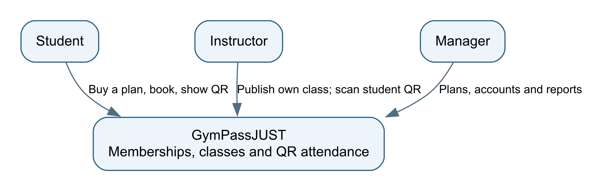

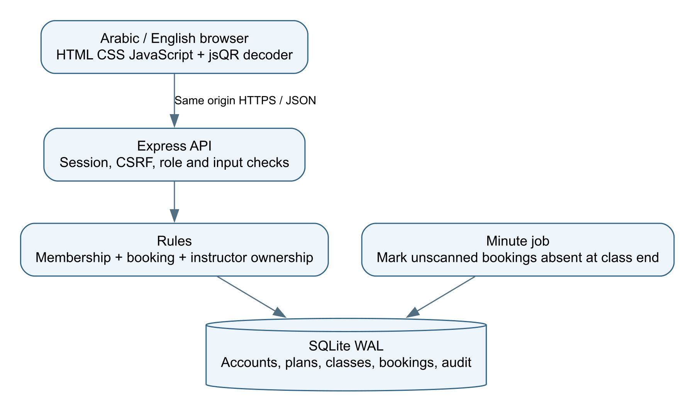

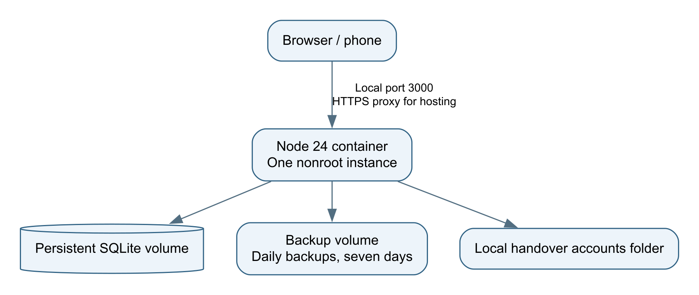

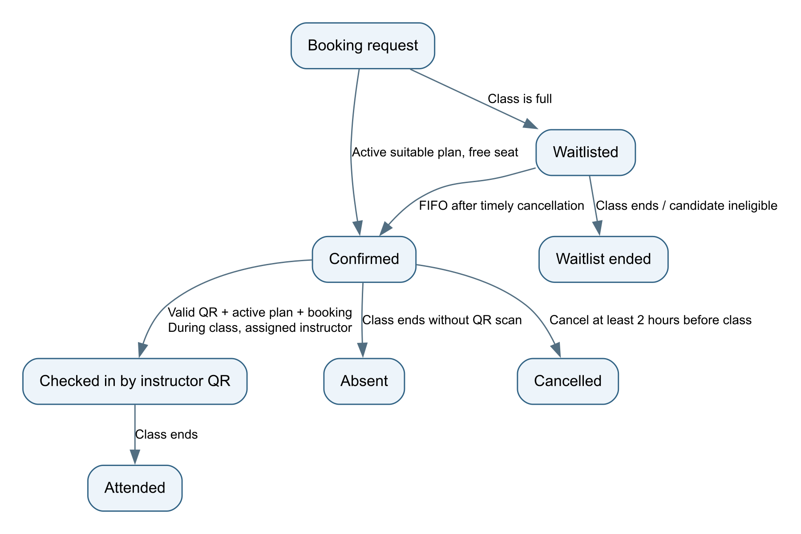

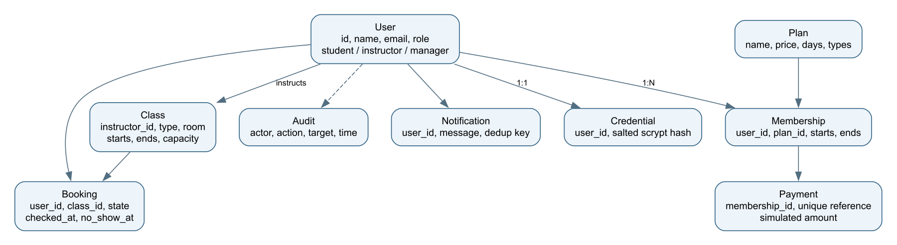

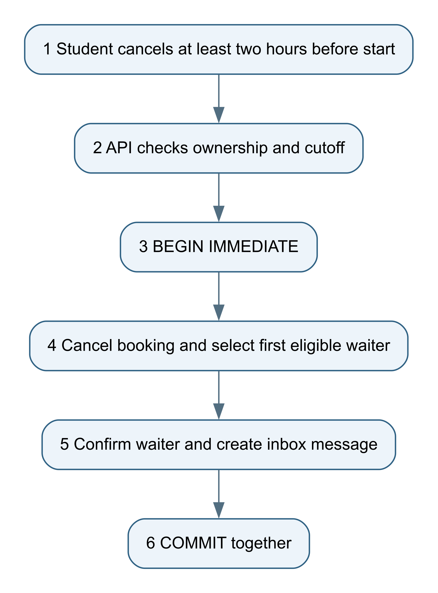

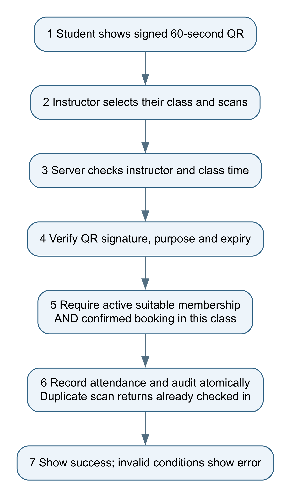

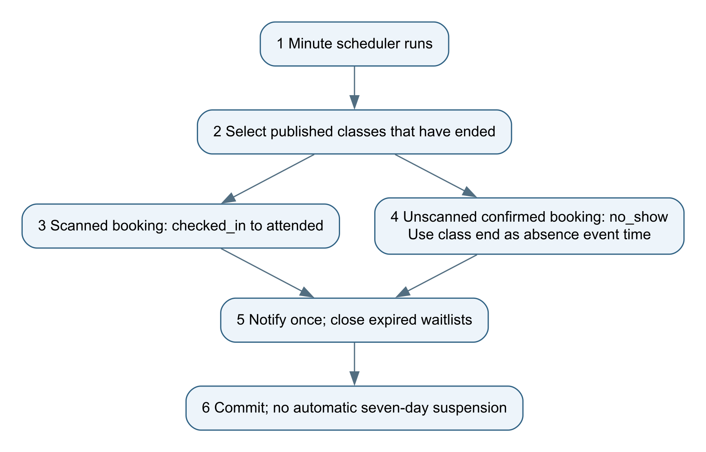

## Five main screen layouts

These wireframes show where the main information and buttons go. The final interface switches Arabic and English and supports phone screens.

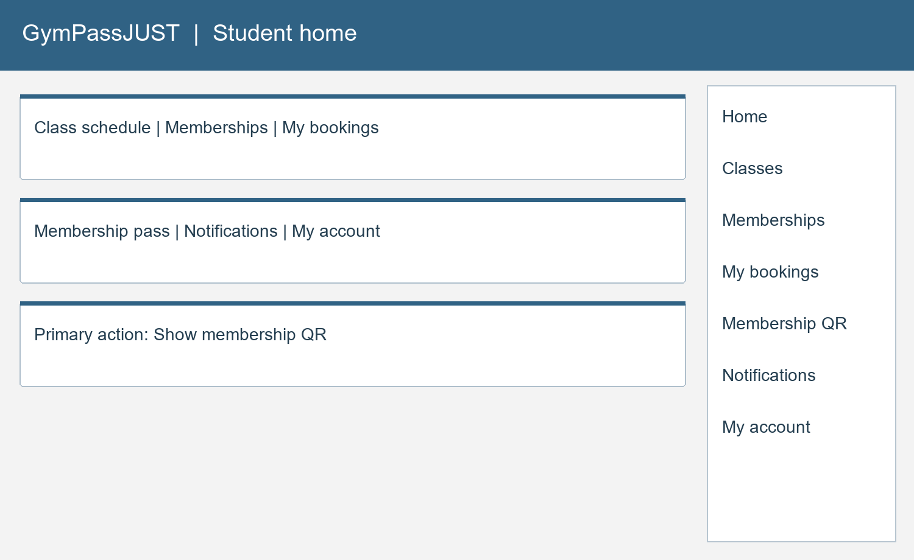

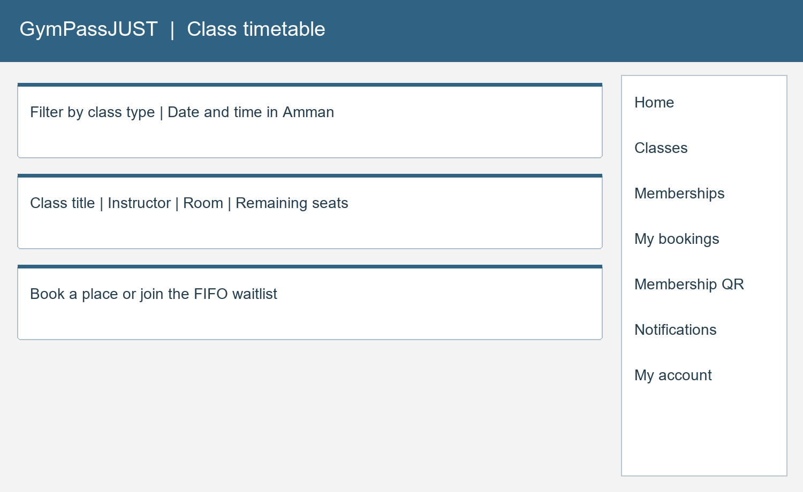

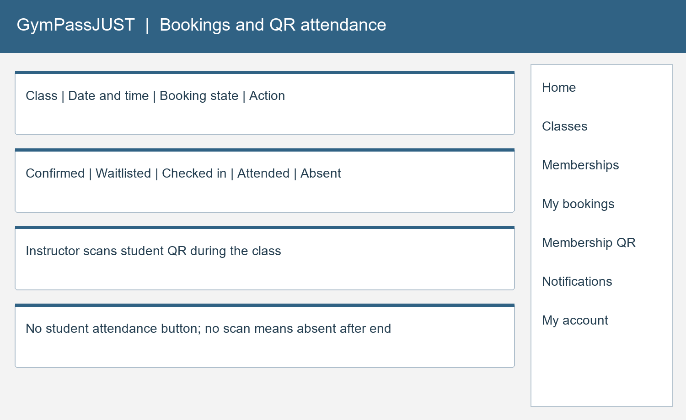

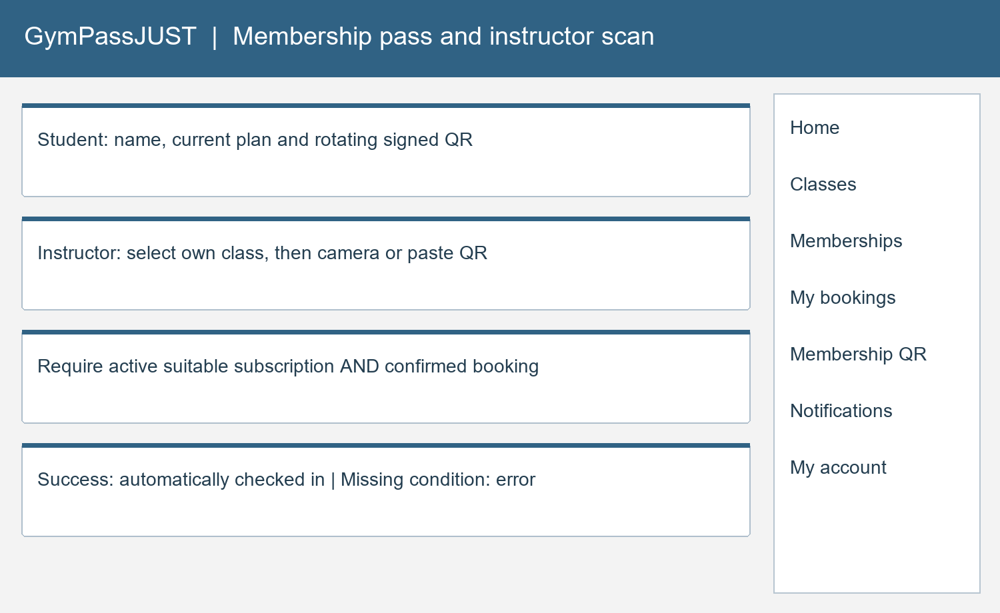

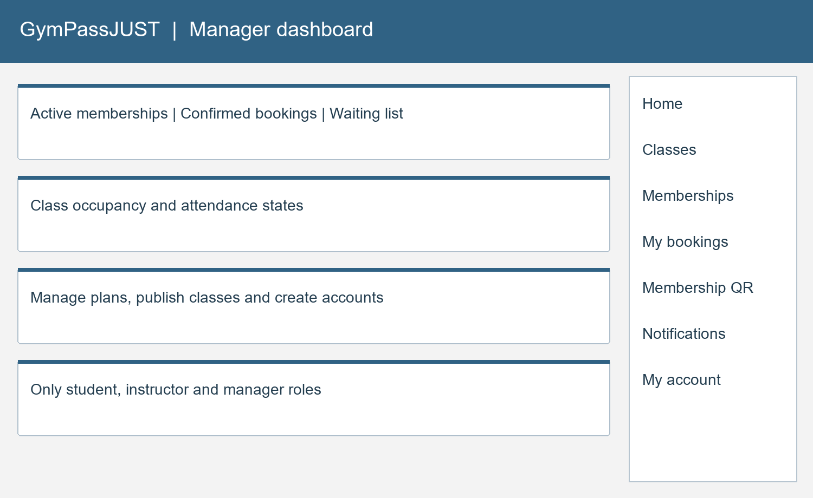

# Appendix B Assistance and remaining records

OpenAI Codex helped draft the code, report text, diagrams and tests, and run local checks. The team must review and understand the work, record its actual changes and complete missing acceptance evidence. This declaration follows textbook section 13.8. No student interviews, signatures or completed five-person study are invented.

# Appendix C References

1. Supplied SE440 textbook, CSP11 GymPassJUST, chapter 13, printed pages 161–170.
2. Supplied course assessment-schedule image, used for the report and discussion dates.
3. Node.js SQLite and testing documentation: https://nodejs.org/docs/latest-v24.x/api/sqlite.html and https://nodejs.org/docs/latest-v24.x/api/test.html.
4. Express and jose documentation: https://expressjs.com/ and https://github.com/panva/jose.
5. OWASP Top 10 2025: https://top10.owasp.org/2025/. The detailed review checklist is in security-checklist.md.

6. jsQR camera fallback, Apache-2.0: https://github.com/cozmo/jsQR.
